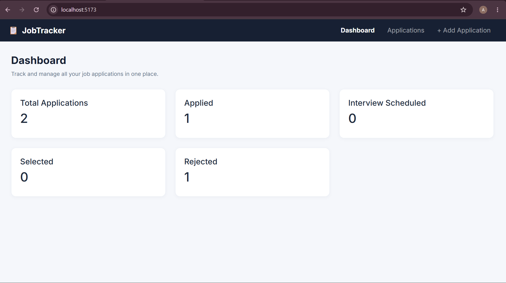
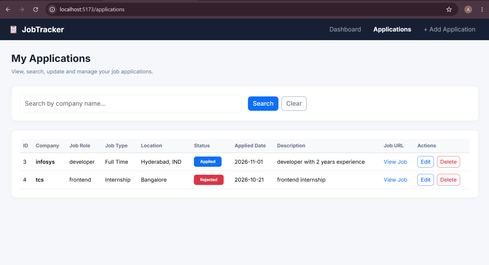
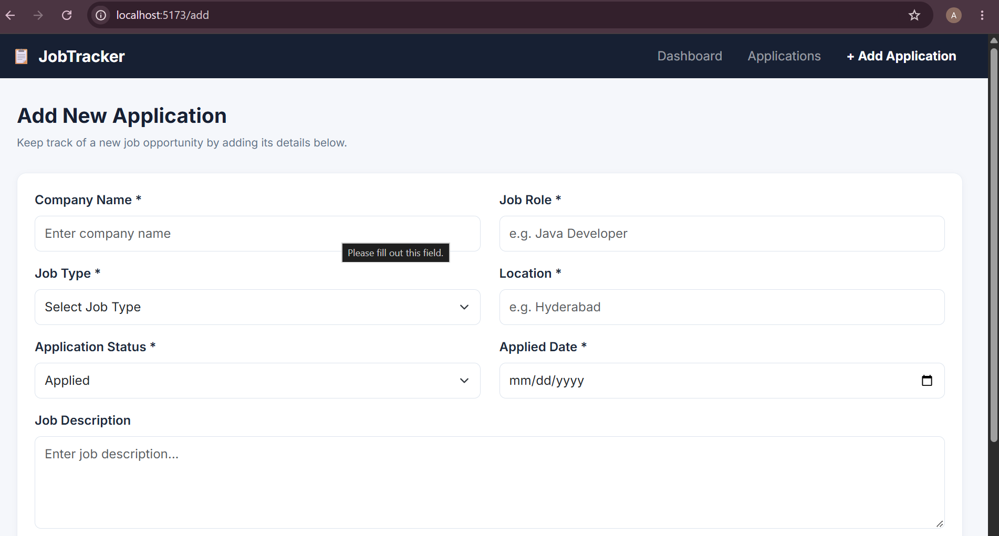
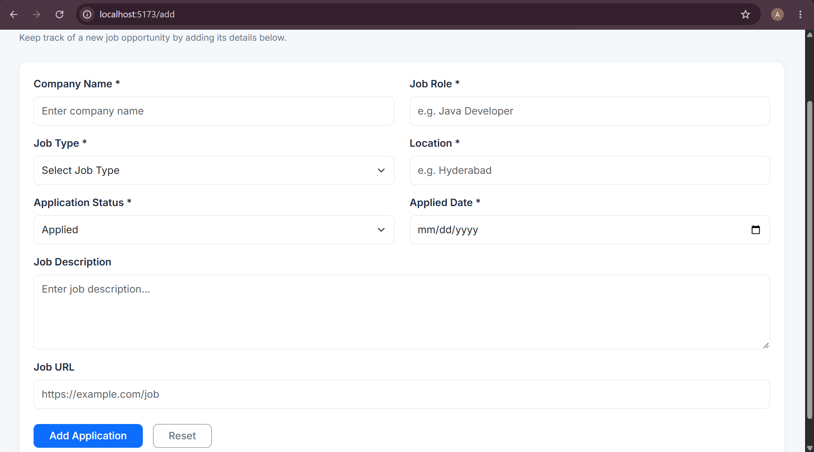

# Job Application Tracker

A full-stack web application designed to help job seekers track and manage their job applications in one place.

## Technologies Used

### Frontend
- React.js
- JavaScript
- Bootstrap 5
- Axios
- React Router

### Backend
- Java
- Spring Boot
- Spring Data JPA
- Hibernate
- REST APIs

### Database
- MySQL

## Features

- Add new job applications.
- View all job applications.
- Search applications by company name.
- Update existing application details.
- Delete job applications.
- Track application statuses:
  - Applied
  - Interview Scheduled
  - Selected
  - Rejected
- Dashboard with application statistics.
- Responsive user interface.

## Project Structure

```text
Job-Application-Tracker/
├── frontend/
│   ├── src/
│   └── package.json
├── backend/
│   ├── src/
│   └── pom.xml
└── README.md
```

## Application Screenshots

Screenshots will be added here.

## Getting Started

### Backend Setup

1. Open the backend project.
2. Configure your MySQL database.
3. Set the `DB_USERNAME` and `DB_PASSWORD` environment variables.
4. Run the Spring Boot application.

Backend URL: `http://localhost:9999`

### Frontend Setup

Navigate to the frontend folder:

```bash
cd frontend
npm install
npm run dev
```

Frontend URL: `http://localhost:5173`

## Screenshots

### 1. Dashboard


### 2. My Applications


### 3. Add Application – Form


### 4. Add Application – Additional View


## Future Improvements

- User authentication and authorization.
- Pagination and advanced filtering.
- Deployment to a cloud platform.

## Author

Abhinay Uppula